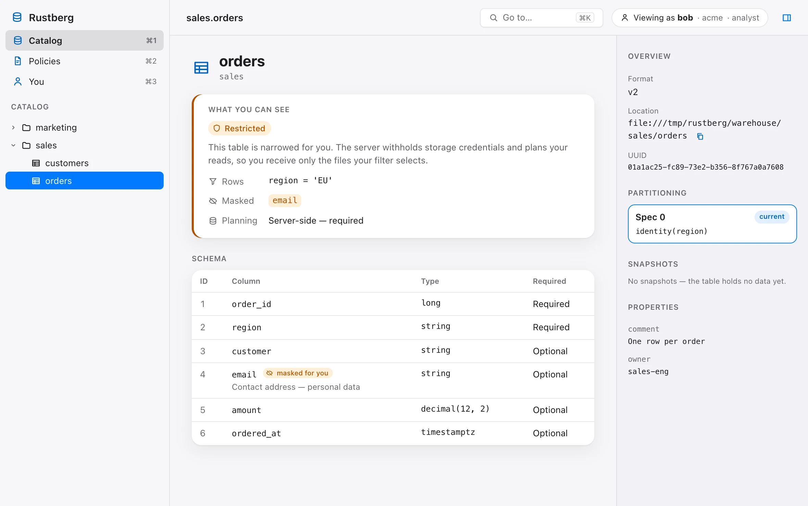

<div align="center">

# Rustberg

**A policy-first Apache Iceberg REST catalog.**

Two first-party registries — one embedded file, or Postgres for HA — with Cedar
policy on every request, storage access scoped to what that policy allows, and
an audit trail that names the rule. A single Rust binary, and an embeddable
crate.

[Documentation](https://hupe1980.github.io/rustberg) ·
[Getting started](https://hupe1980.github.io/rustberg/docs/getting-started/) ·
[API reference](https://hupe1980.github.io/rustberg/docs/api/) ·
[Security](https://hupe1980.github.io/rustberg/docs/security/)


</div>

---

## 🧊 What it is

A complete Iceberg REST catalog, not a proxy in front of one: `redb` for the
embedded case and Postgres for the clustered one, both doing the compare-and-swap
commit themselves and both held to a single conformance suite.

What it is *first* is the policy. Engines connect to one endpoint with one
identity; Rustberg authenticates the caller, authorizes every operation against
[Cedar](https://www.cedarpolicy.com/) policy, hands out storage access scoped to
what that policy allows, and records the decision. Catalogs somebody else runs
can be mounted behind the same endpoint and the same policy — read-only.

```
   Spark · Trino · DuckDB · PyIceberg · Flink
                    │
                    │  one Iceberg REST endpoint, one identity
                    ▼
        ┌───────────────────────────┐
        │         Rustberg          │
        │  identity → policy →      │
        │  routing → storage →      │
        │  audit                    │
        └───────────────────────────┘
              │               │
        ┌─────┘               └──────┐
        ▼                            ▼
     its own                 mounted, read-only
     registry                (Polaris · Lakekeeper
     redb · Postgres          · Unity · Nessie)
```

Storing table pointers is solved. Governing who may read, who may write and who
gets handed storage access is not, and every other subsystem here exists to make
that decision correct, fast and auditable.

## 🚀 Quick start

```bash
brew install hupe1980/tap/rustberg      # macOS (Apple Silicon) and Linux
rustberg --dev --insecure-http
```

Authentication is on by default. With nothing configured, Rustberg mints an
admin key and prints it:

```text
WARN No API keys or OIDC configured — minted a temporary admin key.
WARN     X-API-Key: rb_sOYl2CxcSLwECS2K8Ri8Y14JgqsBpYydrX7hZqVRxrc
WARN     curl -H 'X-API-Key: rb_sOYl…' http://localhost:8000/v1/config
```

The key lives in memory only, so a restart mints a new one — configure
`[[server.auth.api_keys]]` or OIDC for anything lasting.

Open **<http://localhost:8000/ui/>** and paste the key: the built-in
[console](https://hupe1980.github.io/rustberg/docs/console/) shows the catalog
exactly as that credential sees it — which tables are restricted for you, and
how — and lets an administrator edit, review and restore the policy set.

<picture>
  <source srcset="site/static/console/table-restricted-dark.webp" media="(prefers-color-scheme: dark)">
  
</picture>

Then point a client at it:

```python
from pyiceberg.catalog.rest import RestCatalog

catalog = RestCatalog("rustberg", uri="http://localhost:8000", token="rb_...")
catalog.create_namespace("analytics")
```

Without `--dev` Rustberg runs in production mode: it needs an explicit
`--catalog-url` and refuses wildcard CORS.

<details>
<summary><strong>🐳 Docker, Helm, and building from source</strong></summary>

```bash
# Docker — the key is in the startup log; the volume keeps the catalog.
docker run -d -p 8000:8000 --name rustberg \
  -v rustberg-data:/var/lib/rustberg \
  -e RUSTBERG_INSECURE_HTTP=true ghcr.io/hupe1980/rustberg:latest
docker logs rustberg 2>&1 | grep X-API-Key

# Helm, from a clone: Postgres catalog (DSN in a Secret), S3 warehouse
helm install rustberg charts/rustberg \
  --set rustberg.catalog.postgres.existingSecret=rustberg-catalog \
  --set rustberg.warehouse.location=s3://my-bucket/warehouse

# From source — Rust 1.95 or newer, and Node 24 for the console (`just ui`)
cargo build --release --all-features
```

</details>

## 🛡️ Why it exists

- **Cedar policy on every request.** Resources form a tree, so one rule covers a
  namespace subtree, including tables not yet created. Policies are validated at
  load; deny by default, including on evaluation error.
- **Row filters and column masks, enforced.** A restricted table gets no broad
  credential: it is planned server-side and handed pre-signed URLs for exactly
  the files its filter selects. The spec's `read-restrictions` are published too.
- **Listings filter, they do not deny.** What you cannot see is `404`, never `403`.
- **Storage access only narrows.** Vended credentials scoped to one table (STS,
  GCS access boundaries, Azure user-delegation SAS), or remote signing, where the
  engine holds no credential at all.
- **Locations follow names.** A table's files stay under
  `<warehouse>/<namespace>/<name>`, so the storage boundary is the policy boundary.
- **Identity from your provider.** OIDC with discovered keys (RS256, ES256,
  EdDSA); API keys are configuration, named in policy as `ApiKey::"<name>"`.
- **An audit trail that names the rule.** Every decision records the policy and
  policy-set version behind it; if the sink fails, mutations fail with it.
- **A console that shows what you may see**, built in at `/ui`.
- **Federation, a binary or a crate.** Mount other catalogs under one endpoint,
  or embed the same operations in-process behind the same guard.

```cedar
// Analysts read anything under one namespace subtree, and nothing else.
permit(
  principal in Rustberg::Group::"analysts",
  action    in [Rustberg::Action::"Read", Rustberg::Action::"List"],
  resource  in Rustberg::Namespace::"acme\u{1F}analytics"
);

// A pipeline writes to one namespace, outside business hours only.
permit(
  principal == Rustberg::ApiKey::"svc-etl",
  action    in [Rustberg::Action::"Create", Rustberg::Action::"Update"],
  resource  in Rustberg::Namespace::"acme\u{1F}analytics\u{1F}web"
) when { context.utc_hour < 6 || context.utc_hour > 20 };

// Nothing in production is reachable from outside the VPC.
// `context has source_ip` matters: without it, a request whose address is
// unknown would satisfy the exemption and the restriction would not apply.
forbid(
  principal, action,
  resource in Rustberg::Tenant::"prod"
) unless {
  context has source_ip && context.source_ip.isInRange(ip("10.0.0.0/8"))
};
```

→ [Authorization](https://hupe1980.github.io/rustberg/docs/authorization/)

## 📦 Deployment shapes

| | Catalog | Replicas | Use it when |
|---|---|---|---|
| **Single binary** | embedded redb file | exactly one — redb takes an exclusive lock | development, CI, edge, single-node production |
| **Replicated** | Postgres | any number, stateless | Kubernetes, or anything that needs to scale out |
| **Embedded** | in-process | n/a | a Rust service that wants policy and storage access with no network hop |

The warehouse is independent of either: local filesystem, S3, GCS or ADLS.

→ [Catalog and warehouse](https://hupe1980.github.io/rustberg/docs/storage/) ·
[Kubernetes](https://hupe1980.github.io/rustberg/docs/kubernetes/) ·
[Library](https://hupe1980.github.io/rustberg/docs/library/)

## 🔌 Engine support

| Engine | Read | Write | Notes |
|---|---|---|---|
| PyIceberg | ✅ | ✅ | |
| Apache Spark | ✅ | ✅ | including atomic `CREATE TABLE AS SELECT` |
| Trino | ✅ | ✅ | |
| DuckDB | ✅ | — | read-only client |

Table format versions **1, 2 and 3** are served; new tables default to v2.

Conformance suites for PyIceberg, DuckDB and Trino run against the built binary
on every change.

→ [Client configuration](https://hupe1980.github.io/rustberg/docs/clients/)

## 🚧 What it does not do

Each is declined with a status code, never a silent partial success.

- **Rows inside a delivered file are the reader's to filter.** Row filtering is
  enforced per file, so it is end-to-end only where the column is
  identity-partitioned; Rustberg warns at table load when it is not. A pre-signed
  URL is a bearer token until it expires (15 minutes by default), and only S3 is
  pre-signed.
- **Asynchronous and incremental scan planning**: plans are answered inline; an
  incremental scan is `501`.
- **Table maintenance** (compaction, orphan cleanup): a data-path job for an
  external system. Snapshot expiry and purge-on-drop work.
- **Glue, Hive Metastore and S3 Tables mounts**; **SQL UDFs**.
- **Token issuance**: that belongs to your identity provider.

→ [Known limitations](https://hupe1980.github.io/rustberg/docs/api/#known-limitations)

## ⚡ Measured

Release build, `--all-features`, asserted on every pull request with ceilings
that fail the build.

| | Target | Measured (p99) |
|---|---|---|
| Authorization overhead | < 1 ms for point operations | **33 µs** |
| `loadTable` | < 5 ms native | **420 µs** |
| Cold start to serving | < 100 ms | **37 ms** |
| Idle footprint | < 50 MB RSS | **15 MB** |

→ [Performance](https://hupe1980.github.io/rustberg/docs/benchmarks/)

## 🛠️ Development

```bash
just test          # cargo test --all-features
just lint          # clippy -D warnings, rustfmt
just site          # serve the documentation site (requires zola)
just ui            # build the console (Node 24); just ui-dev for live reload
just shots         # retake the console screenshots
```

`just --list` shows the rest.

## 📄 License

Dual-licensed under either of

- Apache License, Version 2.0 ([LICENSE-APACHE](LICENSE-APACHE) or
  <https://www.apache.org/licenses/LICENSE-2.0>)
- MIT license ([LICENSE-MIT](LICENSE-MIT) or <https://opensource.org/licenses/MIT>)

at your option.

### Contribution

Unless you explicitly state otherwise, any contribution intentionally submitted
for inclusion in this crate by you, as defined in the Apache-2.0 license, shall
be dual-licensed as above, without any additional terms or conditions.
