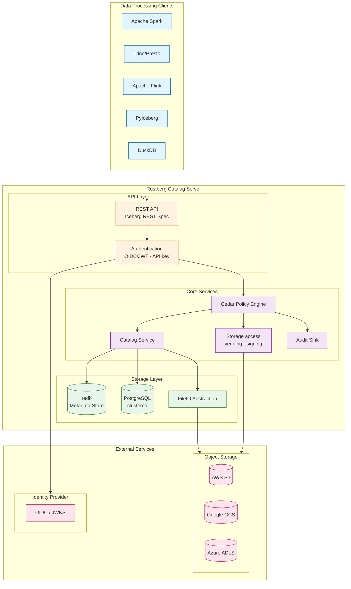
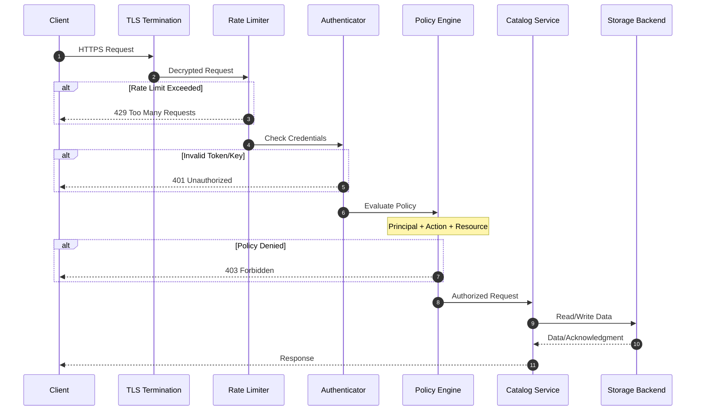
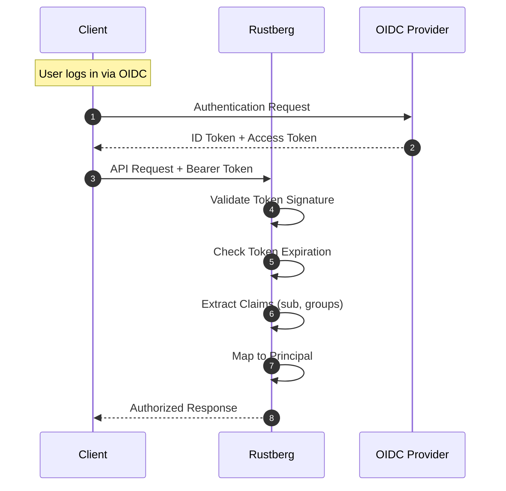
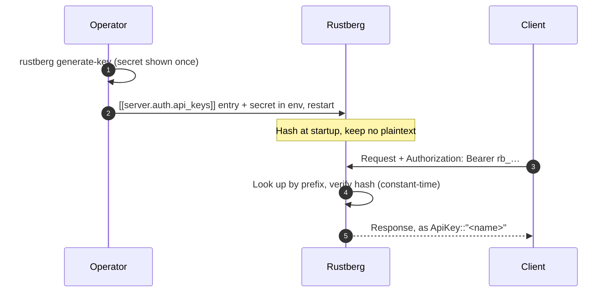
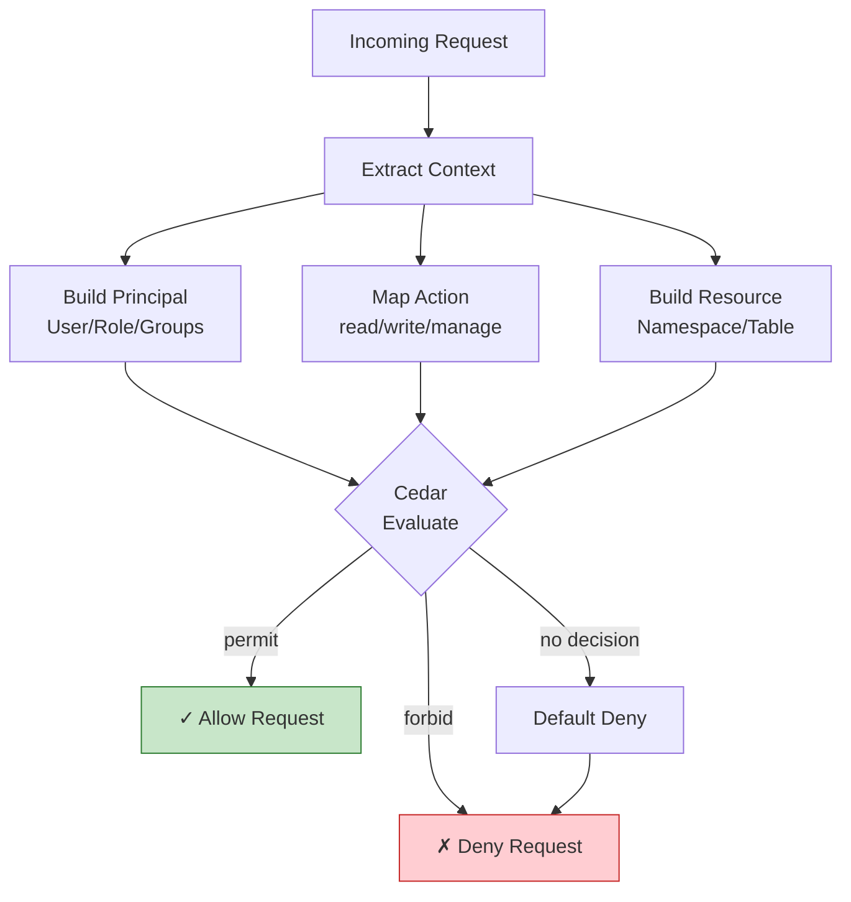
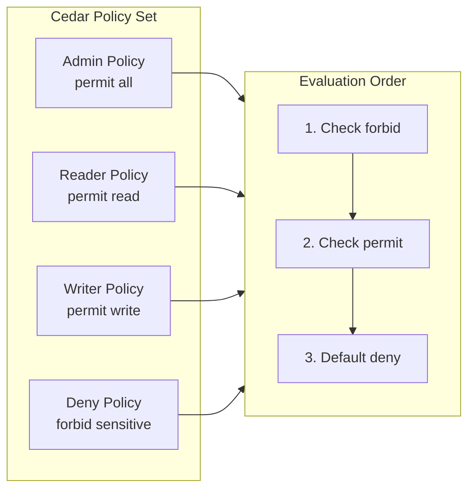
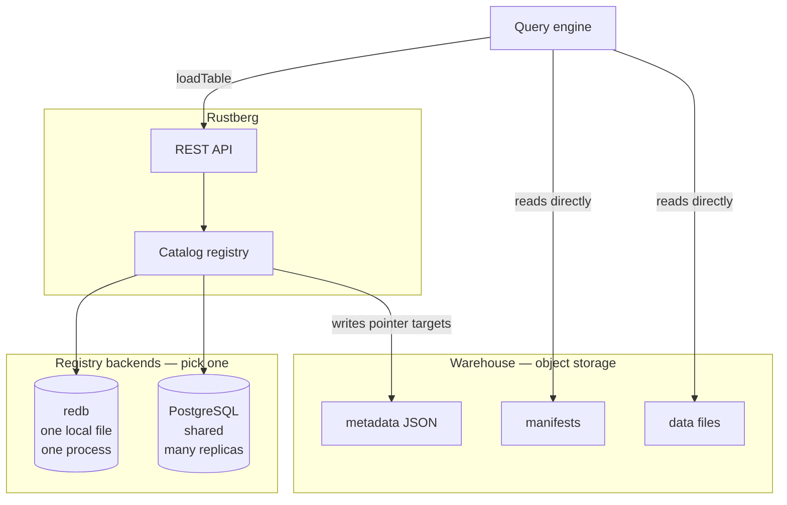
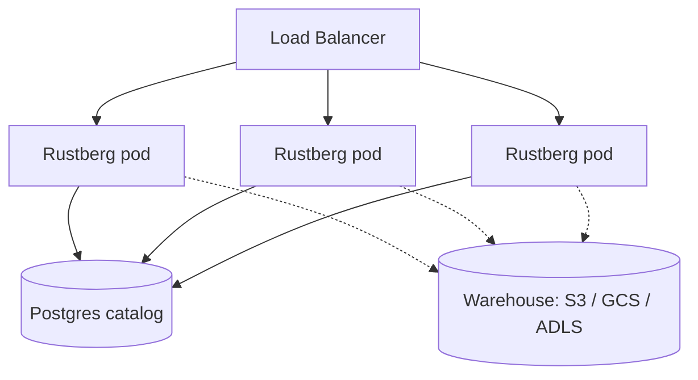
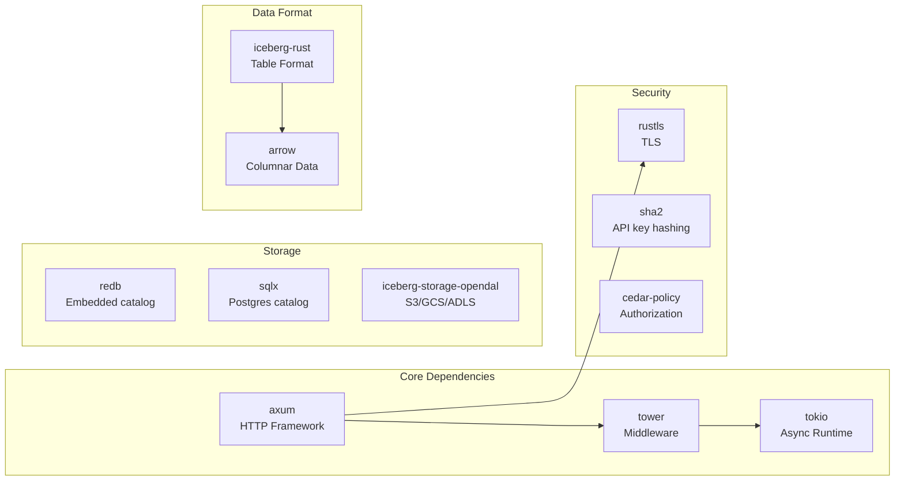
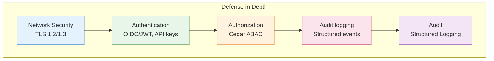

+++
title = "Architecture"
description = "How a request flows through Rustberg: identity, routing, policy, the catalog, credentials, audit."
weight = 2
+++
## System Overview

Rustberg is a modular, layered server.



---

## Request Flow

Every request passes the security pipeline before reaching catalog logic.



---

## Authentication Flow

### JWT/OIDC Authentication



### API Key Authentication



---

## Authorization Model

### Cedar Policy Evaluation



### Policy Structure



---

## Storage Architecture

### Catalog backends

The catalog is a *registry*: one metadata-file pointer per table. Everything an
engine reads lives in the warehouse and is fetched directly.



Both backends implement the same commit protocol:

1. Read the current pointer and metadata; check the request's requirements.
2. Write a **new** metadata file with the updates under a fresh name; never
   overwrite the old one.
3. Swap the pointer, conditional on it still holding the value read in step 1.

Step 3 is a compare-and-swap (redb: serializable write transaction; Postgres:
conditional `UPDATE` in a SQL transaction), so lost updates are impossible. A
swap that matches nothing means another writer won; the commit retries with
backoff.

---

## High Availability

### Replicated deployment



Pods are stateless and equal; Postgres holds the catalog and policy revisions.
The embedded redb catalog runs exactly one pod.

---

## Performance Characteristics

Measured figures — authorization overhead, `loadTable`, cold start, memory — and
how they are gated in CI are on [Performance](@/docs/benchmarks.md).

---

## Component Dependencies



---

## Design Decisions

### Why two catalog backends?

- **redb** (embedded): ACID, multi-key, single-file, no C dependencies, so the
  binary cross-compiles statically to musl. No database to run; a commit is a
  local transaction.
- **Postgres** (clustered): redb's exclusive file lock limits it to one process.
  Postgres lets replicas share one registry without leader election or a
  consensus protocol.

### Why a `CatalogStore` trait instead of `iceberg::Catalog`?

Both registries implement Rustberg's own `CatalogStore`, because
`iceberg::Catalog` cannot serve a REST catalog:

- **No server-side commit.** The only commit method is
  `update_table(TableCommit)`; `TableCommit` has private fields and a
  `pub(crate)` builder. Upstream declined to open it (*"users are not supposed to
  build `TableCommit` directly"*) and points to `Transaction`, which derives
  requirements from typed actions. A REST server must apply the
  `(requirements, updates)` it receives verbatim.
- **No views.** The trait has no view methods.
- **No paging.** `list_tables` returns a `Vec` with no cursor, although both
  registries store tables in a sorted index.

Every implementation (`sql`, `rest`, `glue`, `s3tables`) inherits these.
Rustberg still uses the `iceberg` crate for
`TableMetadata`, `Table`, `ViewMetadata`, `FileIO`, `TableRequirement::check`,
`drop_table_data`, and `iceberg-storage-opendal` for cloud object stores. Only
the registry is written here.

Lakekeeper, the closest comparable project, defines its own catalog trait for the
same reasons.

A federated `rest` mount is a read-only `CatalogStore` whose view support is
negotiated from the remote; see [Federation](@/docs/federation.md).

### Why Cedar?

1. **Expressiveness**: Supports complex ABAC policies
2. **Performance**: Microsecond-level evaluation
3. **Safety**: Formal verification available
4. **Auditability**: Policies are human-readable

## Known Limitations

### Concurrency & Atomicity

| Operation | Status | Notes |
|-----------|--------|-------|
| Table Commit | ✅ CAS with version numbers | Returns 409 Conflict on concurrent modification |
| Table Rename | Atomic | One write transaction inserts the destination and removes the source |
| Multi-table Transaction | Atomic | All pointers swap in one write transaction, each version re-verified inside it |

**Optimistic concurrency control:** every commit swaps the metadata pointer
conditionally on the value it read.

- A lost swap is retried internally with jittered backoff.
- A commit whose *requirements* no longer hold returns `409 Conflict` without
  retry.
- Same behaviour on redb and Postgres — see
  [deployment topology](#concurrency-and-deployment-topology).

**Multi-table atomicity:** `commit_tables_atomic` is all-or-nothing across tables
— one redb write transaction, or one SQL transaction with a conditional `UPDATE`
per table. If any pointer moved, the whole transaction rolls back and retries; no
client sees a half-applied transaction.

### Persistence

| Component | Where it lives | Survives a restart? |
|-----------|----------------|---------------------|
| Namespaces | Catalog registry (redb or Postgres) | Yes |
| Tables | Catalog registry + metadata files | Yes |
| Views | Catalog registry + metadata files | Yes |
| Idempotency receipts | Postgres, when the catalog is Postgres; otherwise in memory | With Postgres |
| API keys | Configuration, hashed in memory | **No** — reloaded from config or the environment on every start |

All *catalog metadata* persists.

- **API keys are configuration, not state**: read from a config file or
  mounted secret and hashed at startup; no key store to encrypt, back up, or
  protect. Rotation is a config change; revocation needs a restart. For runtime
  revocation use OIDC, where the identity provider owns token lifetime.
- **Idempotency receipts follow the catalog**: on Postgres, a retry on another
  replica is replayed, not executed twice; redb has only one process.

### Concurrency and deployment topology

Topology follows from the catalog backend.

#### Postgres: many replicas

Replicas are ordinary stateless pods: any number, rolling updates, autoscaling.
There is no leader; correctness comes from the conditional `UPDATE` in step 3 of
the commit protocol. Two replicas committing to one table concurrently both
succeed, one after retrying.

#### redb: exactly one process

redb locks the catalog file exclusively. A second process fails to open it rather
than contending or corrupting:

```text
Failed to open redb catalog: Database already open. Cannot acquire lock.
```

So: `replicas: 1` with `strategy: Recreate`. A rolling update starts the new pod
before the old one exits, and the new pod cannot open the file.

```
        ┌─────────────┐            ┌─────────────┐
        │  Rustberg   │            │  Rustberg   │  ✗ cannot start
        │ (replicas:1)│            │             │
        └──────┬──────┘            └──────┬──────┘
               │                          │
          ┌────▼──────────────────────────▼────┐
          │        catalog.redb (locked)       │
          └────────────────────────────────────┘
```

For more than one replica, use Postgres.

#### Concurrent commits

Within the process, a redb serializable-snapshot transaction reads and swaps
the registry entry, so a concurrent commit to the same table aborts instead of
overwriting:

- Two requests read version 5 and each build new metadata.
- The first commits; the entry becomes version 6.
- The second loses the swap, re-reads version 6 and re-applies its changes. It
  gets `409 Conflict` only if its requirements no longer hold, or retries run out.

Clients retry `409` with exponential backoff (standard Iceberg contract).

#### Scaling reads

Not on redb: the lock is on the *file*, so a second process cannot open it
read-only either. Scale out with Postgres.

## Security Layers


